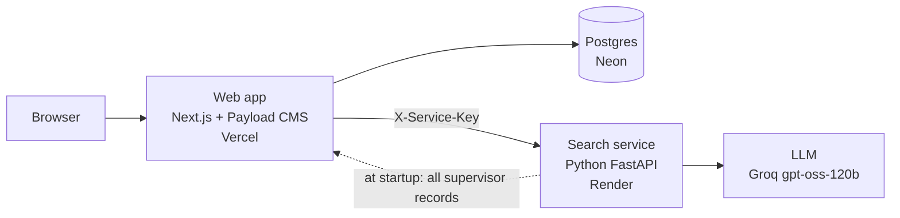
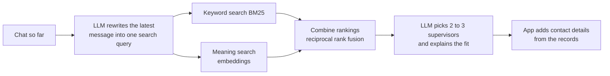

# Supervisor Finder: what we built, how, and why

This page explains the project: the problem it solves, how each part works, and the reasons behind
the design choices. For installing and running it, see [README.md](README.md) and `web/README.md`.

Supervisor Finder is the prototype for our M.Sc. thesis in Technology-Based Business Development
(Aarhus University, BTECH). It is a retrieval-augmented generation (RAG) system for two kinds of
university questions:

1. **"Who should supervise my thesis?"** A student describes an interest in plain words and gets
   matching supervisors, with the reason each one fits, and can send a request.
2. **"What are the travel and expense rules for my trip?"** A finance assistant that answers from
   official documents and knows *which version* of a rule applies to the date in question.

The second part is the thesis contribution. The first part is the working application around it.

> Status: research prototype. It is not official Aarhus University advice, the students and
> requests in the demo are made up, and no real emails are sent.

---

## Contents

1. [The problem](#1-the-problem)
2. [Who uses it](#2-who-uses-it)
3. [How the system is put together](#3-how-the-system-is-put-together)
4. [Finding a supervisor](#4-finding-a-supervisor)
5. [Requests and the coordinator](#5-requests-and-the-coordinator)
6. [Profile changes stay searchable and traceable](#6-profile-changes-stay-searchable-and-traceable)
7. [The admin dashboard](#7-the-admin-dashboard)
8. [The finance assistant (thesis contribution)](#8-the-finance-assistant-thesis-contribution)
9. [Evaluation](#9-evaluation)
10. [Rules the whole system follows](#10-rules-the-whole-system-follows)
11. [Where it runs](#11-where-it-runs)
12. [Known limits and open questions](#12-known-limits-and-open-questions)
13. [Repository map](#13-repository-map)

---

## 1. The problem

**Finding a supervisor.** Students pick supervisors from staff pages and PDF lists of research
interests. Those lists use the researchers' own vocabulary, so a student who writes "AI for
factories" may not find the person who lists "predictive maintenance" and "digital twins". Students
also don't know who still has free slots, and supervisors get vague requests that take time to read.

**Rules that change over time.** Travel and expense rules come from yearly government circulars,
AU policy and AU guidance pages. New versions replace old ones, corrections appear weeks later, and
FAQ answers written under an old version stay online. A standard RAG system puts every version into
one search index and returns whatever text looks most similar to the question. Old and new versions
of a rule look almost identical, so the system can confidently quote a rate that no longer applies,
or one that doesn't apply *yet*. Picking "the newest document" is not a fix either: a trip in 2025
must be answered from the 2025 rules.

A real example from the corpus: the Danish hotel amount appears in five circulars between April 2025
and March 2026. Circular 006-26 printed an inconsistent reduced rate, and 007-26, published four days
later, corrected it. A question about a hotel night in February 2026 has exactly one right source,
and plain similarity search has no way to know which one it is.

---

## 2. Who uses it

| Role | What they can do |
|---|---|
| **Student** | Describe a thesis interest in a chat, refine it ("what about robotics too?"), see 2 to 3 matching supervisors with reasons and thesis ideas, send a request, ask the coordinator for help, see their requests, ask finance questions |
| **Supervisor** | See incoming requests with a short summary, accept, agree to meet, ask for details or decline (each with a confirm step), get a drafted reply email, edit their own profile, lower their slots, ask finance questions |
| **Admin / coordinator** | Dashboard with numbers, demand gaps, profile change history, all requests, coordinator requests (assign a supervisor), data import and export, finance document overview and the finance assistant with all four search systems |

Each role only sees its own data. A supervisor sees only requests sent to them; a student sees only
their own. This is enforced in the database access rules, not just hidden in the interface.

---

## 3. How the system is put together

There are two programs:

- **The web app** (`web/`, Next.js with Payload CMS) handles logins, roles, pages, the database and
  the admin panel. It is the single source of truth for supervisors, students and requests.
- **The search service** (`app.py`, `rag.py`, `finance.py`, Python with FastAPI) does everything
  with embeddings and the language model: indexing, search, answers, note summaries, email drafts and
  the finance assistant.

**Why two programs instead of one?** The machine learning tools (embedding models, PDF parsing) are
best in Python. Logins, access rules, forms and an admin panel are much less work in a web framework
with a CMS. Splitting them means each side uses the tool that fits it.

**How they talk.** The browser never calls the search service directly. The web app calls it from
the server with a shared secret in the `X-Service-Key` header, so the key and the LLM quota can't be
reached from a browser.

**Why the web app owns the data.** The free search service host wipes its disk on every restart.
So at startup the search service downloads every supervisor record from the web app
(`/service/supervisors`) and rebuilds its index. A profile edit is also pushed to the search
service right away (see section 6). Nothing important lives only on the search side.

---

## 4. Finding a supervisor

### The data

The supervisor list comes from the BTECH research interest PDF and staff records, turned into one
JSON record per person (name, position, research areas, research group, email, profile link).
**Each person becomes one search chunk.** We tried splitting PDFs by size first, and two people
regularly ended up in one chunk, which made the LLM mix up who does what.

### The search

1. **Query rewriting.** In a conversation, the latest message often has no topic ("tell me more about
   the first one"). The LLM turns the conversation into one standalone query, replaces "her" or
   "the first one" with names, and expands abbreviations (ML, CV, LLM, IoT).
   *Why:* searching for "tell me more about the first one" finds nothing useful.
2. **Hybrid search.** Two searches run side by side: BM25 keyword search, which is good at exact
   terms like "YOLO" or "ERP", and embedding search (`BAAI/bge-small-en-v1.5`), which finds related
   meaning ("AI for factories" to "predictive maintenance"). The two rankings are combined with
   reciprocal rank fusion (k = 60).
   *Why:* each method fails where the other is strong; fusing ranks avoids having to tune
   score weights.
3. **The answer.** The LLM gets the numbered sources and returns structured JSON: a short message
   plus supervisor cards (name, title, focus, why they fit, three thesis ideas).

### Keeping the LLM honest

The answer prompt separates two kinds of content:

- **Facts about a person** (name, title, research areas) may only come from the sources.
- **Guidance** (why someone fits, thesis ideas) may use general knowledge, and is presented as
  suggestions.

The LLM is not allowed to write emails, links or contact details at all. The app adds them from
the records. *Why:* an invented email address is the most damaging mistake this system could make,
and the easiest way to prevent it is to never let the model produce one.

Without an API key, the app still works in search-only mode and shows the best-matching records.

### Full supervisors

Each supervisor has a number of slots per semester (0 to 7, set by the admin). When the best match
has no free slot, the student still sees that person, plus alternatives from the same search that
do have free slots. *Why:* hiding a full supervisor would hide a correct match; showing only them
would leave the student stuck.

---

## 5. Requests and the coordinator

A student can send three kinds of request:

| Type | Meaning |
|---|---|
| Discuss an idea | An informal first contact, not a supervision agreement |
| Request supervision | A formal request, which uses a slot when accepted |
| Ask the coordinator | "I didn't find anyone, please help": no supervisor chosen yet |

Statuses: pending, more details asked, accepted, rejected. A student can have at most
3 open requests at a time (a value to confirm with the supervisors).

**What the LLM does here, and what it doesn't.** When a request arrives, the LLM writes a
two-sentence summary of the student's note for the supervisor. When the supervisor answers, it
drafts a reply email they can edit and send themselves. **The LLM never decides anything.** Accepting
or declining is always a person's click, with a confirm step ("Yes, accept" / Cancel) so a mis-click
doesn't send an answer.

**The coordinator flow.** A coordinator request has no supervisor. The admin sees it with
suggestions from the same supervisor search (preferring people with known free slots), assigns one,
and it becomes a normal pending request that the supervisor still accepts or declines. *Why:* the
coordinator helps, but the supervisor keeps the final say over their own students.

---

## 6. Profile changes stay searchable and traceable

When a supervisor edits their profile (for example adds a research area):

1. The web app saves it and writes a **profile version**: which fields changed, the old and new
   values, who changed them and when.
2. It sends the new record to the search service, which re-embeds only that person.
3. The next student search finds the new area right away.

*Why:* a matching system is only as good as how current its data is, and the admin needs to see
what changed and when. Unchanged fields (including lists in a different order) don't create
versions, so the history only holds real changes.

---

## 7. The admin dashboard

| Page | What it shows | Why |
|---|---|---|
| Overview | Open requests, requests waiting too long, slots used, searches with a weak match, and a "needs attention" list | A quick health check of the semester |
| Supervisors | Who is full, who has had no requests, empty or old profiles, slots not set | Finds profiles and slots that need updating |
| Demand | What students search for, grouped into topics, and how well the best supervisor matches now | Shows research areas with student demand but no good match (gaps) |
| Changes | The profile version history | Traceability |
| Requests | Assigned, open and stuck requests, longest waiting first | Follow-up on unanswered requests |
| Coordinator | Requests without a supervisor, with suggestions | The coordinator flow |
| Data | Import and export supervisors as CSV | Bulk updates without editing one by one |
| Finance | Which finance documents are loaded, their dates and versions, and the assistant with all four search systems | Checking the corpus and comparing systems |

**Demand gaps** come from query logs that store *what* was searched and the best match score, but
**not who searched**. Similar queries (cosine similarity 0.80 or higher) are grouped as one topic,
and each topic is searched again against the index as it is today, so a gap that a profile edit has
since closed shows the better score.

---

## 8. The finance assistant (thesis contribution)

### The idea

Version-awareness is decided **before** the search, not after. Every document in the finance corpus
has an entry in `data/finance/sources.json`:

| Field | Example | Meaning |
|---|---|---|
| `family` | `state-travel-rates` | What the document is a version of |
| `published_at` | `2026-03-27` | When it was published |
| `effective_from` | `2026-01-01` | From when its rules apply |
| `supersedes` | `["006-26"]` | Which version it replaces |
| `authority` | `state`, `au-policy`, `au-guidance` | Who issued it |
| `checked` | `2026-10-30` | When we verified the entry against the document |

From the question, the system works out the date it is about, then decides per family which
version(s) may be searched at all. Then the normal hybrid search runs, limited to those versions.

### Four systems to compare

All four use the same documents, embeddings, LLM and number of passages. Only the choice of which
versions may be searched differs, so any difference in results comes from that choice.

| System | Searches | Represents |
|---|---|---|
| `plain` | Every version of everything | Conventional RAG |
| `newest` | Only the most recently published version per family | The obvious shortcut |
| `versioned` | The version that applies to the date in question | Our approach |
| `versioned_faq` | `versioned` plus an FAQ check | Our approach, full |

Students and supervisors always get `versioned_faq`. The admin can switch between all four.

### Which version applies

The rule in `finance.py` (`version_for`), in order:

1. **The question names a document** ("what does 006-26 say?"): use that document.
2. **The question asks what the documents said on a past date** ("what did the rules say on
   1 March 2026?"): the newest version *published* by that date, even if it was later corrected.
3. **Otherwise** use the date of the trip or expense (or today if none is given): among the versions
   *in force* on that date, the one published most recently.

Rule 3 is what handles corrections. Circular 007-26 applies from 1 January 2026, like the 006-26 it
corrects, but was published later, so for any 2026 trip it wins, including trips that happened
before the correction was published.

### Reading the date from the question

Before searching, the LLM reads the conversation and returns: a short English search query, the same
query in Danish circular terms (for example "hoteldispositionsbeloeb" for hotel allowance), the event
date, how precise it is (day, month, year), an "as published on" date and a named document, if any.
Without an LLM, simple patterns pick up dates and document numbers from the message.

The answer tells the user which date it assumed ("For a trip or expense on 10 Jun 2025", or "No date
given: based on the rules in force today"), so a wrong assumption is visible.

### The FAQ check

FAQ answers are tied to a rule ID and the policy version they were decided under. When an FAQ entry
shows up in the search results, the system compares that rule's text in the FAQ's version with the
rule's text in the version that applies now:

- **Same text:** the FAQ is still valid and stays in the evidence, even if the policy version changed.
- **Different text:** the FAQ is taken out of the evidence and shown to the user as "outdated FAQ
  left out", with the reason.

*Why compare the rule text and not just the version number?* Most rules don't change between versions.
Flagging every FAQ older than the current version would throw away correct answers.

### Real and synthetic documents, never mixed

The corpus has two parts:

- **Real:** six Danish government rate circulars (056-25, 119-25, 001-26, 002-26, 006-26, 007-26),
  the AU travel policy and AU guidance pages.
- **Synthetic:** a made-up demonstration policy in four versions (v1.0, v2.0, v2.1 correction, v3.0)
  with rule IDs and seven FAQ entries, some of which go stale.

*Why a synthetic policy?* The real documents only have a few kinds of change (yearly rates, one
correction). The synthetic policy lets us test cases the real corpus doesn't have yet: a stale FAQ,
an exception added in a later version, a rule that stayed the same across versions, a question no
version answers.

*Why never mix them?* A real question must never be answered from made-up rules. The user picks the
corpus in the interface, the search is limited to it, synthetic sources are labeled in the evidence,
and the LLM is told to say "in the demonstration policy (synthetic)" whenever it uses one.

### Danish documents

The circulars are in Danish, while questions are mostly in English. The finance search uses a
multilingual embedding model (`paraphrase-multilingual-MiniLM-L12-v2`) and the Danish keyword query
from the understanding step. Annex headings like "Bilag 5 Hoteldispositionsbeløb i Danmark" get a
fixed English label that is carried over to the following pages, so a table that continues onto the
next page is still recognized as the hotel table. *Why not translate the PDFs?* A translation would
not be the official document anymore, and every citation would point to text nobody published.

### The answer

The LLM answers only from the numbered sources, cites every claim ([S1], [S2]), names the version and
the date it applies from, treats amounts as maximum rates under conditions, and never guesses an
amount. Each answer has a status:

| Status | Meaning |
|---|---|
| Answered from the sources | The sources answer it |
| Depends on details | A date or condition is missing |
| Outdated guidance found | An outdated FAQ or two sources disagree |
| Not found in the sources | The user is sent to the finance office |

Every source in the answer shows its authority, version, dates, page and the passage itself, with a
link to the document.

---

## 9. Evaluation

`eval/finance_cases.json` holds 39 test cases: 21 synthetic and 18 real. Each case has a question,
the date context, the rule or annex it is about, which document versions are acceptable, and texts the
answer must contain or must not contain (for example the right amount must appear and the outdated
amount must not).

The scenarios include: a historical rule, the current rule, a correction that applies back in time,
a named superseded document, what a document said on a given date, an amount that went down, a rule
unchanged across years, a stale FAQ, a valid old FAQ, and questions no document answers.

`eval/run_finance_eval.py` runs all four systems on every case and reports real and synthetic
results separately:

| Metric | Question it answers |
|---|---|
| `right_version_top` | Is the first passage for the rule from an acceptable version? |
| `wrong_version_in` | Does the evidence contain the same rule from a version with different text (something the LLM could wrongly repeat)? |
| `stale_faq_in` | Does the evidence contain an FAQ that is outdated for this case? |
| FAQ check precision and recall | Does `versioned_faq` flag the right FAQ entries, against a hand-written table? |
| Answer checks (`--answers`) | Does the answer contain every expected text and no forbidden one? |

By default the evaluation uses the hand-labeled dates, so it measures version selection on its own.
With `--understand`, the LLM reads the dates from the questions, which measures the full pipeline.
Every run is saved to `eval/results/`, so each number in the thesis can be traced to a run.

Two real cases are marked `needs_check`: the Danish hotel amount for February 2025 and February 2026.
Their correct answer depends on how the finance office applies the yearly hotel agreement adjustment,
and we are waiting for their confirmation instead of guessing.

---

## 10. Rules the whole system follows

- **The LLM never decides.** It summarizes, suggests and drafts. People accept, decline and assign.
- **Facts only from sources.** Names, titles, research areas, amounts and rules come from the
  records and documents. The LLM's own knowledge is only used for clearly marked guidance.
- **No generated contact details.** Emails and links are added by the app from the records.
- **Show the evidence.** Every finance answer shows its sources, versions and dates; every match
  links to the profile.
- **Say when unsure.** "Not found in the sources" and "depends on details" are valid answers.
- **Made-up data is labeled.** Demo students, demo requests and the synthetic policy are marked as
  such everywhere they appear.
- **Privacy by default.** Query logs store what was searched, not who searched. Secrets stay on the
  servers.

---

## 11. Where it runs

| Part | Host | Note |
|---|---|---|
| Web app | Vercel (Hobby, Frankfurt region) | Deploys from GitHub |
| Database | Neon Postgres (free) | Local development uses SQLite |
| Search service | Render (free) | Sleeps after 15 minutes without traffic |
| LLM | Groq | `openai/gpt-oss-120b` |

The search service waking up takes up to about a minute. The web app handles this: if the service
answers with a gateway error or can't be reached, it waits until `/api/health` responds (up to
75 seconds) and tries again once, and the page tells the user that the service is waking up.

---

## 12. Known limits and open questions

- **Circular 001-26 is listed but its file is missing**, so the 2026 chain is incomplete for anything
  that relied on it.
- **Two real evaluation cases wait for the finance office** (see section 9).
- **Results with the real embedding model** still need to be run and reported.
- **Values to confirm with the supervisors:** who owns the slot numbers, the limit of 3 open
  requests, and whether the coordinator suggests or assigns.
- **No real emails yet.** Drafts are shown to the supervisor to copy; notifications are logged.
- **The research group filter is hidden** because most supervisors don't have a group recorded yet.
- **Finance documents are managed as files**, not yet through the admin panel.
- **The free search host sleeps and has monthly limits**, which suits a prototype, not real use.
- **Scope:** only travel and expense rules. Study rules are a possible next step.

---

## 13. Repository map

| Path | What it is |
|---|---|
| `app.py` | Search service API: chat, finance chat, reindexing, summaries, email drafts, demand gaps, health |
| `rag.py` | Reading PDFs and records into chunks, embeddings, hybrid search, supervisor prompts |
| `finance.py` | Version-aware finance search: the four systems, version selection, FAQ check, answers |
| `ingest.py` | Builds the search indexes |
| `data/finance/sources.json` | The finance document catalogue with dates and versions |
| `data/finance/official/` | The real circulars and AU documents |
| `data/finance/synthetic/` | The demonstration policy (four versions) and its FAQ |
| `scripts/make_synthetic_policy.py` | Generates the synthetic policy files |
| `eval/finance_cases.json` | The 39 evaluation cases and the FAQ gold table |
| `eval/run_finance_eval.py` | Runs the evaluation and saves the results |
| `web/src/collections/` | Database collections: users, students, supervisors, requests, profile versions, query logs |
| `web/src/access.ts` | Who can read and change what |
| `web/src/lib/python.ts` | Calls from the web app to the search service, including the wake-up retry |
| `web/src/app/(frontend)/` | The student, supervisor and dashboard pages |
| `web/src/seed.ts`, `web/src/seed-demo.ts` | Create the logins and supervisors, and the demo data |

---

**Team:** Abu Zobayer Bin Siddique and Md. Tareq Hossain. **Supervisor:** Syed Ali Hassan.
Aarhus University, Department of Business Development and Technology (BTECH).