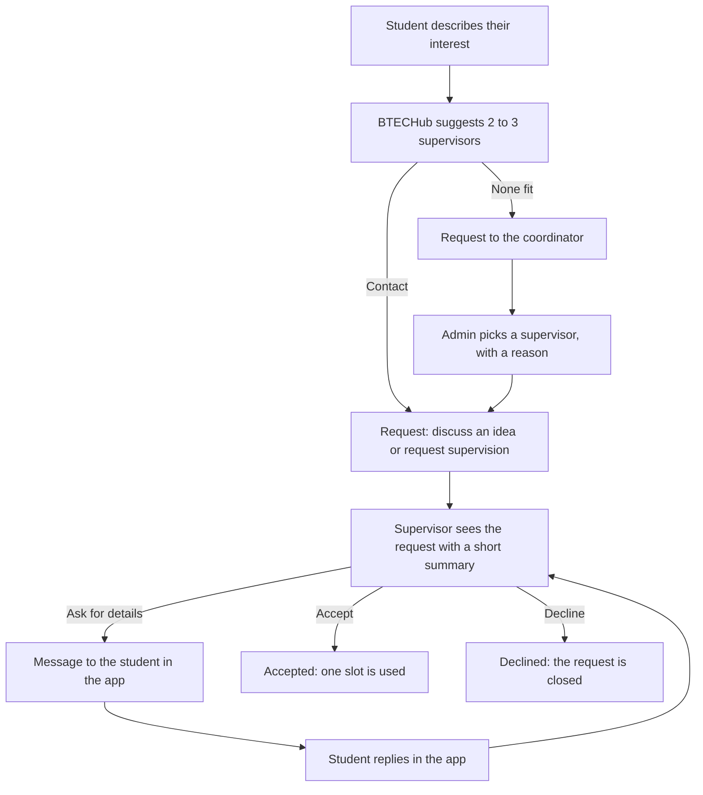
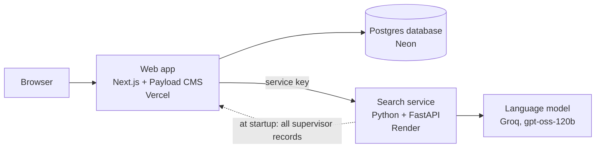
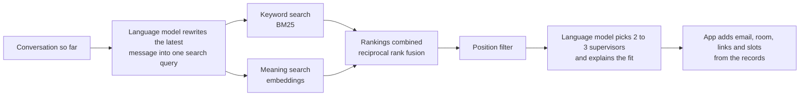

# BTECHub

**BTECHub helps students at BTECH (Aarhus University) find a thesis supervisor, contact them and agree on supervision, in one place.**
A student describes their interest in plain words and gets matching supervisors, with the reason each one fits. Supervisors
answer requests and talk to students in the app. The admin keeps the staff data current and sees where students can't find a match.

Live prototype: https://supervisor-finder.vercel.app

> BTECHub is the prototype for an M.Sc. thesis in Technology-Based Business Development (Aarhus University, BTECH).
> It is a research prototype, not an official AU service. Students and requests in the demo are made up, and no real emails are sent.

---

## Contents

1. [The problem](#1-the-problem)
2. [Who uses it](#2-who-uses-it)
3. [A request from start to finish](#3-a-request-from-start-to-finish)
4. [How the system is put together](#4-how-the-system-is-put-together)
5. [Finding a supervisor](#5-finding-a-supervisor)
6. [Requests, messages and the coordinator](#6-requests-messages-and-the-coordinator)
7. [Keeping the staff data current](#7-keeping-the-staff-data-current)
8. [The admin dashboard](#8-the-admin-dashboard)
9. [Rules the whole system follows](#9-rules-the-whole-system-follows)
10. [Evaluation and quality assurance](#10-evaluation-and-quality-assurance)
11. [The travel and expense module (paused)](#11-the-travel-and-expense-module-paused)
12. [Where it runs](#12-where-it-runs)
13. [Run it on your own computer](#13-run-it-on-your-own-computer)
14. [Known limits](#14-known-limits)
15. [Repository map](#15-repository-map)

---

## 1. The problem

Choosing a supervisor is slow and uncertain for both sides.

- **Students** pick supervisors from staff pages and PDF lists written in the researchers' own vocabulary. A student who
  writes "AI for factories" may not find the person who lists "predictive maintenance" and "digital twins". Students also
  don't know who still has room for another thesis.
- **Supervisors** get vague emails that take time to read, with no overview of who asked what and when.
- **The department** has no view of what students look for, which topics nobody covers, or which requests wait too long.
  Staff lists go out of date as people change their research.

BTECHub puts the search, the request, the answer and the conversation in one place, and keeps the staff data current.

---

## 2. Who uses it

| Role | What they can do |
|---|---|
| **Student** | Describe a thesis interest in a chat and refine it ("what about robotics too?"); see 2 to 3 matching supervisors with reasons, thesis ideas and free slots; filter by position; send a request; ask the coordinator for help; follow their requests and reply to supervisors |
| **Supervisor** | See incoming requests with a short summary; accept, agree to meet, ask for details or decline (each with a confirm step); edit an email draft; message the student in the app; edit their own research areas; lower their slots |
| **Admin / coordinator** | See an overview of requests and slots; find topics students search for that nobody covers; see every profile change; assign a supervisor to students who asked the coordinator; upload staff list PDFs and CSV files; export the data |

Each role sees only its own data. A supervisor sees only requests sent to them; a student sees only their own. This is
enforced by the database access rules, not just hidden in the interface.

---

## 3. A request from start to finish



Every answer is a person's decision. The language model summarizes notes and drafts emails; it never accepts, declines or assigns.

---

## 4. How the system is put together



There are two programs:

- **The web app** (`web/`, Next.js with Payload CMS) handles logins, roles, pages, requests, messages, the database
  and the admin panel. It is the single source of truth for supervisors, students and requests.
- **The search service** (`app.py`, `rag.py`, `staffpdf.py`, Python with FastAPI) does everything with embeddings and
  the language model: the search index, supervisor search, note summaries, email drafts, demand grouping and reading
  staff list PDFs.

**Why two programs?** The machine learning tools (embedding models, PDF reading) are best in Python. Logins, access
rules, forms and an admin panel are much less work in a web framework with a CMS. Each side uses the tool that fits it.

**How they talk.** The browser never calls the search service directly. The web app calls it from the server with a
shared secret (the `X-Service-Key` header), so the key and the language model quota can't be reached from a browser.

**Why the web app owns the data.** The free search service host wipes its disk on every restart. So at startup the
search service loads every supervisor record from the web app and rebuilds its index, and every profile change is
pushed to the search service right away. Nothing important lives only on the search side.

---

## 5. Finding a supervisor

### The data

The staff list comes from the BTECH research interest list and the staff pages: one record per person, with name,
position, research areas, research group, email, room and profile link. Search covers the positions that can supervise a
thesis: professors (including Distinguished Professor and Professor (Docent)), associate and assistant professors, and
postdocs. PhD students and research assistants stay in the data but are not suggested.

**Each person is one search unit.** Splitting PDFs by size put two people in one piece of text, and the language model
then mixed up who does what.

### The search



1. **Query rewriting.** In a conversation, the latest message often has no topic ("tell me more about the first one").
   The language model turns the conversation into one standalone query, replaces "her" or "the first one" with names,
   and expands abbreviations such as ML, CV and LLM.
2. **Hybrid search.** Keyword search (BM25) is good at exact terms such as "YOLO" or "ERP". Meaning search
   (`BAAI/bge-small-en-v1.5` embeddings) finds related wording, such as "AI for factories" and "predictive maintenance".
   The two rankings are combined with reciprocal rank fusion (k = 60), which needs no tuning of score weights.
3. **Position filter.** Ticking Professor, Associate Professor, Assistant Professor or Postdoc limits the search. When
   the student changes the filter after an answer, the last question is asked again and the answer is replaced.
4. **The answer.** The language model returns structured output: a short message plus supervisor cards (name, title,
   research areas, why they fit, three thesis ideas). Follow-up questions about a person get paragraphs instead of cards.

### Keeping the language model honest

- **Facts about a person** (name, title, research areas) may only come from the staff records.
- **Guidance** (why someone fits, thesis ideas) may use general knowledge, and is presented as suggestions.
- **Contact details** are never written by the language model. The app adds email, room and profile link from the
  records, because an invented email address is the most damaging mistake this system could make.

Without a language model key, BTECHub still works in search-only mode and shows the best-matching records.

### Full supervisors

Each supervisor has a number of supervision slots per semester (0 to 7, set by the admin). When a good match has no free
slot, the student still sees that person, plus alternatives with free slots. A student can still ask a full supervisor to
discuss an idea.

---

## 6. Requests, messages and the coordinator

| Request type | Meaning |
|---|---|
| Discuss an idea | Informal first contact; doesn't use a slot when accepted |
| Request supervision | A formal request; uses one slot when accepted |
| Ask the coordinator | "I didn't find anyone": no supervisor chosen yet |

Statuses: waiting for an answer, more details asked, accepted, declined.

**Limits.** A student has at most 3 open requests, and one open request per supervisor. Accepting a supervision request
is checked on the server against the supervisor's free slots, so two acceptances can't overbook.

**Answering.** Every answer has a confirm step ("Yes, accept" / Cancel). After confirming, the supervisor gets an email
draft written for this student. They can edit it, clear it and write their own, copy it, open it in Outlook, or send it in
the app.

**Messages.** Each request has a conversation in the app. When a supervisor asks for details, the student sees the message
under My requests with the reply box open, and the supervisor sees a "Student replied" tag when the answer arrives. Either
side can write until the request is declined. Each new message also creates an email notice to the other person, which
is written to the server log until an email service is connected.

**The coordinator.** A coordinator request has no supervisor. The admin sees it with suggestions from the same search,
preferring people with free slots, picks one, adds a reason and confirms. It then becomes a normal supervision request
that the supervisor accepts or declines. The coordinator helps, but the supervisor keeps the final say.

---

## 7. Keeping the staff data current

A matching system is only as good as its data. BTECHub keeps it current in three ways.

**1. Supervisors edit their own profile.** Research areas, what they expect from students, room, and their slots
(lower only). Saving:

- writes a **profile version**: which fields changed, old and new values, who changed them and when;
- re-indexes only that person, so the next student search finds the change right away.

**2. The admin uploads files.** On Import/export, the admin chooses one or more staff list PDFs, CSV files, or both.

- **PDFs** are read as a table with name, position (or designation) and research areas, like the BTECH list. People are
  matched to existing records by profile link, then by name.
- **CSV files** use the exported format and are matched by `record_id`.
- The admin sees who is **new**, who **changed** and which fields, and which file and page each row came from, before
  anything is saved.
- **Research areas a supervisor edited themselves are kept**, unless the admin ticks a box to replace them. Otherwise an
  older PDF would undo the supervisor's own edits.
- **Nobody is deleted.** People missing from the uploaded files are only listed, because one PDF may cover only part of
  the department.
- Saved changes go through the same path as profile edits: versioned and searchable right away.

**3. The data can be exported.** CSV for Excel, and JSON in the same format as `data/supervisors.json`, so the file in the
repository can be refreshed from the live data.

---

## 8. The admin dashboard

| Page | What it shows | Why |
|---|---|---|
| Overview | Open requests, requests waiting over 7 days, slots used, searches with a weak match, a "needs attention" list | A quick check of the semester |
| Supervisors | Who is full, who has had no requests, empty or old profiles, slots not set | Finds profiles and slots to update |
| Requests | Assignments, open requests, requests waiting longest | Follow-up on unanswered requests |
| Coordinator | Students waiting for the coordinator, with suggestions | The coordinator flow |
| Demand | What students search for, grouped into topics, and how well the best supervisor matches today | Shows topics with student demand but no good match |
| Changes | Every profile change, old value next to new | Traceability |
| Import/export | PDF and CSV upload with preview; CSV and JSON export | Bulk updates |
| Admin panel | The Payload admin panel | Direct access to all records |

**Demand without surveillance.** Search logs store what was searched and how well the best match scored, but not who
searched. Similar searches (cosine similarity of 0.80 or more) are grouped into one topic. Each topic is searched again
against today's data, so a gap that a profile edit has since closed shows the better score.

---

## 9. Rules the whole system follows

- **The language model never decides.** It summarizes, suggests and drafts. People accept, decline and assign.
- **Facts only from the records.** Names, titles and research areas come from the staff data.
- **No generated contact details.** Emails and links are added by the app.
- **Confirm before anything irreversible.** Answering a request and assigning a supervisor both have a confirm step.
- **Nothing is lost silently.** Every profile change is versioned; imports never delete; supervisors' own edits are protected.
- **Made-up data is labeled.** Demo students, requests and searches are marked "demo" everywhere.
- **Privacy by default.** Search logs don't store who searched. Keys stay on the servers.

---

## 10. Evaluation and quality assurance

### Search quality

`eval/supervisor_cases.json` holds test questions with the supervisors that should be found, some labeled by
supervisors themselves. `eval/run_eval.py` runs every case with each search mode and saves the run to `eval/results/`,
so each number in the thesis traces back to a run.

Results of 30 October 2026, 19 scored cases, search only (no language model):

| Search mode | Right person ranked first | Expected people in the top 10 |
|---|---|---|
| Keyword (BM25) | 0.95 | 0.80 |
| Meaning (embeddings) | 0.95 | 0.92 |
| Hybrid (used by BTECHub) | 0.84 | 0.97 |

Hybrid search finds almost everyone who fits, but ranks the single best person first less often. With 19 cases, one case
moves a score by about 0.05, so these differences are indicative, not conclusive. The test set is being extended, and
the thesis adds a check that answers don't invent facts about people and a small user test with students and supervisors.

### Quality assurance

Before each release, the system is checked against a QA checklist (about 170 checks: login, each role's tasks, imports,
access control, the search service, error states, phones and accessibility). A shorter live QA sheet covers what users
see on the live site and is run by a second person.

---

## 11. The travel and expense module (paused)

BTECHub also contains a **version-aware assistant for travel and expense rules**, built as the first extension beyond
supervisors. It is switched off for now to keep the focus on students and supervisors.

**The idea.** Rules such as hotel allowances and mileage rates come from yearly government circulars and AU pages. New
versions replace old ones, corrections appear weeks later, and FAQ answers outlive the rules they were based on. A
standard search returns whatever text looks most similar, so it can quote last year's rate. The module decides **which
version applies to the date in question before searching**, and leaves out FAQ answers whose rule has changed since.
It compares four search strategies on 39 test cases (21 synthetic, 18 based on real Danish circulars).

**Why it is off.** It needs a second, multilingual embedding model for the Danish circulars. With both models loaded,
the search service needs about 770 MB of memory, and the free hosting plan allows 512 MB.

**How to switch it on.** Change the active line in **both** files, then redeploy the search service on a host with at
least 1 GB of memory:

```python
# rag.py
FINANCE_ENABLED = False
# FINANCE_ENABLED = True
```

```ts
// web/src/lib/features.ts
const FINANCE_ENABLED = false
// const FINANCE_ENABLED = true
```

The code, documents and evaluation (`finance.py`, `data/finance/`, `eval/run_finance_eval.py`) stay in the repository.
The finance evaluation runs locally even while the module is switched off.

---

## 12. Where it runs

| Part | Host | Note |
|---|---|---|
| Web app | Vercel (Hobby plan, Frankfurt) | Deploys on every push to `main` |
| Database | Neon Postgres (free plan) | Local development uses SQLite |
| Search service | Render (free plan) | Deployed by hand; sleeps after 15 minutes without traffic |
| Language model | Groq | `openai/gpt-oss-120b` |

Waking the search service takes up to about a minute. The web app handles this: if the service doesn't answer, it waits
until `/api/health` responds (up to 75 seconds) and tries once more, and the page tells the user it is waking up.

---

## 13. Run it on your own computer

You need Python 3.12 and Node.js. Never commit a `.env` file.

**Search service** (repository root):

```
python -m venv .venv
.venv\Scripts\activate          (macOS/Linux: source .venv/bin/activate)
pip install -r requirements.txt
copy .env.example .env          (fill in LLM_API_KEY and SERVICE_KEY; set SEARCH_MODE=hybrid)
python ingest.py
uvicorn app:app --reload
```

**Web app** (`web/` folder, in a second terminal):

```
copy .env.example .env          (fill in PAYLOAD_SECRET, and the same SERVICE_KEY)
npm install
npm run seed                    (creates the database and the three demo logins)
npm run seed:demo               (optional: demo requests, slots and searches)
npm run dev
```

Then open http://localhost:3000 and log in as `student@example.com`, `supervisor@example.com` or `admin@example.com`
with the `SEED_PASSWORD` from `web/.env`.

**After changing database fields** (files in `web/src/collections/`), run `npm run seed` against the database again.
Against the live database this also rewrites every supervisor from `data/supervisors.json`, so live profile edits are lost.

---

## 14. Known limits

- **No real emails.** Messages live in the app; email notices are written to the server log.
- **Database changes use the seed script,** which overwrites live supervisor data. Before real use, this should move to
  database migrations.
- **The free search service sleeps,** so the first search after a quiet period takes up to a minute.
- **Six staff members have no research areas** in the data and can't be found until someone fills them in.
- **PDF import expects a table** with name, position and research areas, like the BTECH list. Other layouts are reported,
  not guessed.
- **Open decisions with the department:** who sets supervision slots, the limit of 3 open requests, and whether the
  coordinator suggests or assigns.
- **Login is a demo login,** not AU single sign-on.

---

## 15. Repository map

| Path | What it is |
|---|---|
| `app.py` | Search service API: chat, re-indexing, note summaries, email drafts, demand groups, staff PDF reading, health |
| `rag.py` | Turning records into search units, embeddings, hybrid search, prompts, the finance switch |
| `staffpdf.py` | Reads a staff list PDF (a table) into supervisor rows |
| `ingest.py` | Builds the search index |
| `finance.py` | The travel and expense module (paused) |
| `data/supervisors.json` | The staff records used to fill a new database |
| `data/finance/` | Circulars, AU pages and the synthetic test policy for the finance module |
| `eval/` | Test cases, evaluation scripts and saved results |
| `web/src/collections/` | Database collections: users, students, supervisors, requests (with messages), profile versions, search logs |
| `web/src/access.ts` | Who can read and change what |
| `web/src/lib/python.ts` | Calls from the web app to the search service, including the wake-up retry |
| `web/src/lib/brand.ts` | The app's name, in one place |
| `web/src/lib/features.ts` | The finance switch for the web app |
| `web/src/app/(frontend)/` | Student, supervisor and dashboard pages |
| `web/src/seed.ts`, `web/src/seed-demo.ts` | Create the logins and supervisors, and the demo data |

---

**Team:** Abu Zobayer Bin Siddique and Md. Tareq Hossain. **Supervisor:** Syed Ali Hassan.
Aarhus University, Department of Business Development and Technology (BTECH).
